<div align="center">



**Sua IA opera seu PC pelo chat. As travas de segurança rodam no seu PC.**

[](LICENSE)
[](https://nodejs.org)
[](#requisitos)
[](#como-funciona)
[](SKILL.md)
[](#contribuindo)

</div>

---

> **Você é uma IA** (Claude, ChatGPT, Gemini, Cursor, agente de código)? Leia
> [`SKILL.md`](SKILL.md) primeiro. A skill traz o passo a passo de instalação,
> o que pedir ao usuário, a tabela das 23 ações e as regras de segurança.
> Comece pela Regra de Ouro #0: pergunte se o PC é Windows ou Linux.

## O que é

`agent.js` é um agente de um arquivo só, em Node puro e sem dependências, que
roda no seu PC e conversa com a sua IA por meio de um relay (API routes Next.js
hospedado numa VM). A IA enfileira comandos; o agente busca, executa localmente
e devolve o resultado. O agente só abre conexões de saída, com poll a cada
1,5 s, então funciona atrás de NAT e de firewall doméstico: nenhuma porta
aberta, nenhum SSH.

```
┌──────────────────┐  poll 1,5 s     ┌──────────────────────┐  admin token  ┌────────────┐
│    SEU PC        │ ──────────────► │  relay Next.js       │ ────────────► │    IA      │
│  Windows/Linux   │ ◄────────────── │  /api/ponte/*        │ ◄──────────── │ (chat ou   │
│    agent.js      │  POST /result   │  URL pública https   │  injeta cmd   │  agente)   │
│   (zero deps)    │                 │  fila + resultados   │  + lê resposta│            │
└──────────────────┘                 └──────────────────────┘               └────────────┘
```

- **Agente** (seu PC): 23 ações de arquivo e comando, escopo travado na sua
  home, lixeira com desfazer e trava anticatástrofe dentro do próprio processo,
  antes de executar. Desde a v1.4.0, leitura universal: `file_info` identifica
  o formato por magic bytes (png, pdf, exe, mp4, zip) e `read_text`/
  `read_binary` leem arquivos de qualquer tamanho em pedaços (`offset` →
  `proximoOffset`). Desde a v1.5.0, modo Deus opcional (run_command sem
  confirmações s/N; a ativação é conversacional: a IA pergunta no chat depois
  de conectar) e skill que se auto-atualiza: o agente baixa a SKILL.md do repo
  no boot e a cada 6 h.
- **Relay** (VM/servidor): fila com entrega exclusiva (claim/lease), sequência
  persistida em disco e painel web com status em tempo real.
- **Operador** (CLI Python na VM): `ponte.py` injeta comandos e lê resultados
  pelo terminal, com binários em base64 (`enviar`/`pegar`).

## Segurança em camadas

| Camada | O que faz |
|--------|-----------|
| **Escopo na home** | O agente recusa qualquer caminho fora da home do usuário. `.ssh`, `.gnupg`, `.config`, `.password-store`, `.aws`, `.kube` e a própria pasta `ponte-agent` ficam inacessíveis. |
| **Lixeira com undo** | A IA não apaga nada em definitivo: `delete` e substituições vão para a lixeira do agente, com log JSONL auditável e `undo_last`/`restore`. |
| **Trava anticatástrofe** | O agente recusa localmente, antes de executar: fork bomb, `mkfs`, `wipefs`, `dd of=/dev/*`, `shred` em disco, `rm -r` de sistema. No Windows, `format`, `diskpart`, `cipher /w`, `vssadmin delete shadows`, `rd /s`/`del /s`/`Remove-Item -Recurse` em raiz de drive, `C:\Windows`, `C:\Program Files` ou `$HOME`. |
| **Consentimento no modo** | `run_command` só funciona nos modos que você religa no seu terminal. O modo Deus é a exceção consentida: a IA pergunta no chat e só ativa com o seu aceite. |
| **Tokens separados** | Agente e operador usam tokens distintos; comandos de teste ficam num canal isolado. |
| **Log JSONL** | Toda ação fica registrada em `ponte-log.jsonl`, com resumo e dados de undo. |

## Os 4 modos do `run_command`

| Modo | Como ativa | Comportamento |
|------|------------|---------------|
| **Desligado** (padrão) | `node agent.js` | Só operações de arquivo; a IA não executa comandos. |
| **Supervisionado** | `node agent.js --allow-run --save` | Cada comando aparece no seu terminal; `s`/`N` em 60 s; sem resposta, o agente rejeita. |
| **Autônomo** | `node agent.js --auto --save` | Executa direto (loga `[AUTO] $ cmd`), com a trava anticatástrofe ativa. |
| **Modo Deus** | A IA pergunta no chat depois de conectar e, com o seu aceite, envia `god_mode {"enabled":true}` | Igual ao autônomo (loga `[DEUS] $ cmd`); trava, lixeira e log continuam; desliga com `god_mode {"enabled":false}`. |

Os modos supervisionado e autônomo mudam só com um flag digitado por você no
terminal do seu PC. O modo Deus fica salvo em `ponte.config.json` e sobrevive a
restarts; se você recusar o pedido da IA, a recusa fica registrada e ela não
pergunta de novo.

## Requisitos

| Onde | O quê |
|------|-------|
| **Seu PC** (Windows ou Linux) | Node.js 18+, `curl` (no Windows, o `curl.exe` nativo do PowerShell) |
| **VM/servidor da IA** | Node.js 18+ para o relay (Next.js), Python 3 opcional para a CLI |

## Comece por aqui

### Caminho 1: deixe a IA instalar (recomendado)

Abra um chat com sua IA e diga: *"leia https://github.com/MicaelSanPedro/ponte-local/blob/main/SKILL.md e instale a ponte pra mim"*. A skill guia relay, tokens, download do agente, validação e o primeiro comando. A ponte já está no ar? Diga *"leia o SKILL.md e opere minha ponte"* colando URL + ADMIN_TOKEN: Claude, Manus ou qualquer IA com `curl` opera sem hospedar nada.

### Caminho 2: manual

**No servidor** (detalhes completos em [`SKILL.md`](SKILL.md) e [`relay/RESTAURAR.md`](relay/RESTAURAR.md)):

```bash
CI=1 npx create-next-app@latest ponte-relay --typescript --app --no-eslint --src-dir --import-alias "@/*"
cd ponte-relay
# copie os arquivos do repo conforme a tabela da SKILL.md:
#   relay/ponte-store.ts  → src/lib/ponte-store.ts
#   relay/api/*/route.ts  → src/app/api/ponte/*/route.ts
#   relay/painel/page.tsx → src/app/page.tsx
#   agente/agent.js       → download/ponte-agent/agent.js
export PONTE_AGENT_TOKEN=$(openssl rand -hex 12)   # vai para o seu PC
export PONTE_ADMIN_TOKEN=$(openssl rand -hex 16)   # só para quem injeta comandos
npm install lucide-react
npm run dev    # Next.js 16+? deixe cacheComponents: false no next.config.ts (ver SKILL.md)
```

**No seu PC, Linux:**

```bash
mkdir -p ~/ponte-agent && cd ~/ponte-agent
curl -fso agent.js https://raw.githubusercontent.com/MicaelSanPedro/ponte-local/main/agente/agent.js
node agent.js --server https://SEU-RELAY --token SEU_TOKEN --save
```

**No seu PC, Windows (PowerShell):**

```powershell
mkdir "$HOME\ponte-agent" -Force; cd "$HOME\ponte-agent"
curl.exe -fso agent.js https://raw.githubusercontent.com/MicaelSanPedro/ponte-local/main/agente/agent.js
node agent.js --server https://SEU-RELAY --token SEU_TOKEN --save
```

> Atenção: no PowerShell, use sempre `curl.exe`. O `curl` sem `.exe` é um alias
> do `Invoke-WebRequest` e quebra o download. Próximas execuções:
> `~/ponte-agent/rodar.sh` (Linux) ou `cd $HOME\ponte-agent; node agent.js`
> (Windows).

## As 23 ações do agente

| Grupo | Ações |
|-------|-------|
| **Explorar** | `ping` · `list` · `tree` · `search` (nome ou conteúdo) · `free_space` · `disk_usage` · `file_info` (tipo real por magic bytes) |
| **Arquivos** | `read_text` (qualquer tamanho, em pedaços) · `write_text` · `mkdir` · `move` · `rename` · `delete` → lixeira · `restore` · `undo_last` |
| **Organizar** | `organize_plan` (propõe, não executa) · `apply_plan` (lote aprovado) · `duplicates` (md5 + espaço recuperável) |
| **Binários** | `read_binary` (por pedaços, sem teto de tamanho) · `write_binary` (até 8 MB, via `ponte.py pegar`/`enviar`) |
| **Comando** | `run_command` (com os modos acima) |
| **Controle** | `god_mode` (liga/desliga as confirmações; a IA só ativa após o seu aceite no chat) · `skill_update` (força o download da SKILL.md; o agente também atualiza sozinho no boot e a cada 6 h) |

A referência completa, com argumentos exatos, está na
[tabela da SKILL.md](SKILL.md#fase-4--operar-referência-das-ações).

## Estrutura do repo

```
ponte-local/
├── SKILL.md               ← entrada para IAs: instale e opere (comece aqui)
├── agente/
│   ├── agent.js           ← o agente inteiro: 1 arquivo, 0 dependências (v1.5.1)
│   ├── LEIA-ME.md         ← manual do agente no PC do usuário
│   ├── rodar.sh           ← religa lendo ponte.config.json (Linux)
│   └── atualizar.sh       ← baixa a versão nova do agente (Linux)
├── relay/
│   ├── ponte-store.ts     ← estado do relay: fila, claim/lease, seq em disco
│   ├── api/…/route.ts     ← poll · result · cmd · results · status · download
│   ├── painel/page.tsx    ← painel web opcional (status em tempo real)
│   └── RESTAURAR.md       ← recriar o relay do zero numa VM nova
├── operador/
│   ├── ponte.py           ← CLI do operador (injeta comandos, lê resultados)
│   └── teste-ponte*.sh    ← testes E2E de referência
└── docs/banner.svg        ← banner do repo
```

## Perguntas frequentes

**A IA pode formatar meu PC?** Não. O agente recusa comandos de destruição em
massa antes de executar, apaga arquivos só para a lixeira (com undo) e não
enxerga nada fora da sua home.

**A IA pode ligar o `run_command` sozinha?** Os modos supervisionado e autônomo
só mudam com um flag digitado por você no terminal do seu PC. O modo Deus é a
exceção consentida: a IA pergunta no chat e só ativa com o seu aceite; a recusa
fica registrada.

**Preciso abrir portas no meu roteador?** Não. O agente faz requests de saída
para o relay; o que atravessa a internet é JSON de metadados. Conteúdo de
arquivo não fica no ar: binários vão em base64, sob demanda, por comando seu.

**Funciona no Windows?** Sim, desde o agente v1.3.0: `run_command` via
`cmd.exe`, trava anticatástrofe com padrões Windows e lixeira interna do
agente (não é a Lixeira do Windows; restaure com `restore`/`undo_last`).

**E arquivos enormes (vídeo, ISO, log de 1 GB)?** A leitura é por pedaços:
`file_info` diz o formato real (magic bytes), `read_text`/`read_binary` leem de
`offset` em `offset` (até 6 MB por chamada) e devolvem `proximoOffset`. O
arquivo inteiro não precisa caber na memória nem na ponte.

## Contribuindo

Abra issues e PRs. Relatos do agente em outras distros e no Windows são os mais
úteis; para mudanças maiores, descreva o caso de uso numa issue antes.

## Licença

[MIT](LICENSE) © MicaelSanPedro
