<div align="center">



**Sua IA opera seu PC pelo chat. As travas de segurança rodam no seu PC.**

Instale em um comando, sem instalar nada — **no seu PC físico**:

```bash
npx ponte-local start --server https://SEU-RELAY --token SEU_TOKEN --save
```

> Este pacote é **híbrido**: o mesmo `npx` serve a dois lados diferentes.
> A [IA que opera na VM](#dois-lados-dois-comandos) usa `npx ponte-local
> skill` — um comando **só de leitura**, que não sobe nada no seu PC.

[](LICENSE)
[](https://www.npmjs.com/package/ponte-local)
[](agente/agent.js)
[](relay/ponte-store.ts)
[](https://nodejs.org)
[](#requisitos)
[](#vis%C3%A3o-geral)
[](SKILL.md)
[](#contribuindo)

</div>

---

> **Você é uma IA** (Claude, ChatGPT, Gemini, Cursor, agente de código)? Leia
> [`SKILL.md`](SKILL.md) primeiro. A skill traz o passo a passo de instalação,
> o que pedir ao usuário, a tabela das 33 ações e as regras de segurança.
> Comece pela Regra de Ouro #0: pergunte se o PC é Windows ou Linux.

## Sumário

1. [Visão geral](#visão-geral)
2. [Como funciona](#como-funciona)
3. [Destaques](#destaques)
4. [Segurança em camadas](#segurança-em-camadas)
5. [Os 4 modos do `run_command`](#os-4-modos-do-run_command)
6. [Requisitos](#requisitos)
7. [Primeiros passos](#primeiros-passos)
8. [As 33 ações do agente](#as-33-ações-do-agente)
9. [Estrutura do repositório](#estrutura-do-repositório)
10. [Destaques por versão](#destaques-por-versão)
11. [Perguntas frequentes](#perguntas-frequentes)
12. [Aviso legal, privacidade e uso responsável](#aviso-legal-privacidade-e-uso-responsável)
13. [Contribuindo](#contribuindo)
14. [Segurança](#segurança)
15. [Licença](#licença)

## Visão geral

**Ponte Local** liga a sua IA ao **seu** computador. Um agente de um arquivo só
(`agent.js`, Node puro, **zero dependências**) roda no seu PC e conversa com a
sua IA por meio de um relay — rotas de API Next.js hospedadas numa VM que
**você** controla. A IA enfileira comandos; o agente busca, executa
localmente e devolve o resultado.

O agente só abre conexões **de saída**, com poll a cada 1,5 s. Por isso
funciona atrás de NAT e de firewall doméstico: nenhuma porta aberta, nenhum
SSH, nada para configurar no roteador.

| Componente | Onde roda | Tecnologia | Papel |
|------------|-----------|------------|-------|
| **Agente** — `agent.js` | no seu PC | Node.js 18+, 1 arquivo, 0 dependências | executa as 33 ações localmente, com escopo, lixeira e trava anticatástrofe no próprio processo |
| **Relay** — `ponte-store.ts` + rotas | na sua VM/servidor | Next.js (API routes) | fila por máquina (lane), sequência persistida em disco, painel de status |
| **Operador** — `ponte.py` | na sua VM/servidor | Python 3, só biblioteca padrão | CLI para injetar comandos e ler resultados pelo terminal |

## Como funciona

```
┌──────────────────┐  poll 1,5 s     ┌──────────────────────┐  admin token  ┌────────────┐
│    SEU PC        │ ──────────────► │  relay Next.js       │ ────────────► │    IA      │
│  Windows/Linux   │ ◄────────────── │  /api/ponte/*        │ ◄──────────── │ (chat ou   │
│    agent.js      │  POST /result   │  URL pública https   │  injeta cmd   │  agente)   │
│   (zero deps)    │                 │  fila + resultados   │  + lê resposta│            │
└──────────────────┘                 └──────────────────────┘               └────────────┘
```

1. A IA publica o comando na **lane** da máquina — cada PC tem token e fila
   próprios; comando de uma máquina nunca executa na outra.
2. O agente, que faz poll a cada 1,5 s, recebe o comando em segundos.
3. O agente valida **localmente**, antes de executar: escopo travado na sua
   home, destruição em massa recusada, apagar vai para a lixeira com undo.
4. O resultado volta para o relay; a IA lê e continua a tarefa.
5. A IA fecha com `task_done`: o agente grava um relatório TXT com o que foi
   feito e **abre na sua tela** (Windows, Linux e macOS).

## Destaques

- **Zero dependências no seu PC** — o `agent.js` roda com a API padrão do
  Node.js; nada de `npm install`, nada de build.
- **Funciona atrás de NAT** — só conexões de saída para o relay; nenhuma
  porta aberta, nenhum SSH exposto.
- **Segurança executada no seu PC** — escopo na home, lixeira com desfazer e
  trava anticatástrofe rodam dentro do agente, antes de cada ação.
- **Multi-máquina sem cruzar filas** — uma lane por máquina, autenticada por
  token próprio; nada hardcoded: tokens só no `.env` do servidor e no
  `ponte.config.json` de cada PC.
- **Lê qualquer arquivo** — `file_info` identifica o formato real por magic
  bytes (png, pdf, exe, mp4, zip) e a leitura é por pedaços, sem teto de
  tamanho: vídeo, ISO e log de gigabytes não estouram memória nem a ponte.
- **Pronto para IA** — a `SKILL.md` ensina qualquer IA com `curl` a instalar
  e operar; o agente baixa e atualiza a skill sozinho (boot + a cada 60 s,
  com ETag: 304 = zero bytes).
- **Sem telemetria** — nenhum dado vai para os autores: os únicos contatos
  de rede do agente são o seu relay e o `raw.githubusercontent.com`.

## Segurança em camadas

| Camada | O que faz |
|--------|-----------|
| **Escopo na home** | O agente recusa qualquer caminho fora da home do usuário. `.ssh`, `.gnupg`, `.config`, `.password-store`, `.aws`, `.kube` e a própria pasta `ponte-agent` ficam inacessíveis. Desde a v1.11.0 o escopo valida `realpath`: symlink e junction não furam mais a home, e credenciais (`.env`, `.npmrc`, `.git-credentials`, config e log do agente) estão bloqueadas para leitura remota. |
| **Lixeira com undo** | A IA não apaga nada em definitivo: `delete` e substituições vão para a lixeira do agente, com log JSONL auditável e `undo_last`/`restore`. |
| **Trava anticatástrofe** | Recusa localmente, antes de executar: fork bomb, `mkfs`, `wipefs`, `dd of=/dev/*`, `shred` em disco, `rm -r` de sistema, `&&` no meio do comando, flags como `--no-preserve-root`, `find -delete`, `xargs` destrutivo, `tee`/redirect para `/dev/*`, script baixado da internet e executado direto no shell, `chmod/chown -R` em pasta do sistema, `rm` com `$VAR` ou `..`. No Windows: `format`, `diskpart`, `cipher /w`, `vssadmin delete shadows`, `rd /s`/`del /s`/`Remove-Item -Recurse` em raiz de drive, `C:\Windows`, `C:\Program Files` ou `$HOME`. |
| **Consentimento no modo** | `run_command` só funciona nos modos que você religa no seu terminal. O modo deus é a exceção consentida: a IA pergunta no chat e só ativa com o seu aceite. |
| **Mouse com Aviso** | As ações de mouse usam a ferramenta do sistema (`xdotool` no X11, `user32` no Windows, `ydotool` no Wayland). No Wayland, se cair no `xdotool` (que só mexe no cursor do XWayland), a resposta vem com `aviso` — a IA é instruída a ler e a te avisar. |
| **Tokens separados** | Agente e operador usam tokens distintos; **uma lane por máquina** (token e fila próprios — comando não atravessa). Tokens nunca vão para o código nem para o repo: só no `.env` do servidor e no `ponte.config.json` de cada PC (permissão 0600). |
| **Log JSONL** | Toda ação fica registrada em `ponte-log.jsonl`, com resumo e dados de undo. |
| **Entrega confiável** | Sequência persistida em disco (reiniciar o relay não perde fila), reconnect entrega pendentes com menos de 24 h, resultado reenviado com retry: rede caiu ≠ comando perdido. |

## Os 4 modos do `run_command`

| Modo | Como ativa | Comportamento |
|------|------------|---------------|
| **Desligado** (padrão) | `npx ponte-local start` | Só operações de arquivo; a IA não executa comandos. |
| **Supervisionado** | `npx ponte-local start --allow-run --save` | Cada comando aparece no seu terminal; `s`/`N` em 60 s; sem resposta, o agente rejeita. |
| **Autônomo** | `npx ponte-local start --auto --save` | Executa direto (loga `[AUTO] $ cmd`), com a trava anticatástrofe ativa. |
| **modo deus** | A IA pergunta no chat depois de conectar e, com o seu aceite, envia `god_mode {"enabled":true}` | Igual ao autônomo (loga `[deus] $ cmd`); trava, lixeira e log continuam; desliga com `god_mode {"enabled":false}`. |

Os modos supervisionado e autônomo mudam só com um flag digitado por você no
terminal do seu PC. O modo deus fica salvo em `ponte.config.json` e sobrevive
a restarts; se você recusar o pedido da IA, a recusa fica registrada e ela não
pergunta de novo.

## Requisitos

| Onde | O quê |
|------|-------|
| **Seu PC** (Windows, Linux ou Termux/Android) | Node.js 18+, `curl` (no Windows, o `curl.exe` nativo do PowerShell) |
| **VM/servidor da IA** | Node.js 18+ para o relay (Next.js), Python 3 opcional para a CLI |

### Só para as ações de screenshot

O resto do agente é **zero dependências** — mas tirar print da tela depende
de uma ferramenta de captura que a distro já traz. Não é preciso instalar
nada no Windows (PowerShell + System.Drawing são nativos), mas no Linux
escolha **uma** das opções:

| Sessão | Pacote | Comando | Janela por título? |
|--------|--------|---------|--------------------|
| X11 (qualquer distro) | `imagemagick` | `import` | sim (com `xdotool`) |
| X11 | `scrot` | `scrot` | não (só tela inteira) |
| X11 | `maim` | `maim` | não |
| Wayland/KDE | `spectacle` | `spectacle` | janela em foco |
| Wayland/Hyprland | `hyprshot` | `hyprshot` | janela em foco |
| Wayland/GNOME | `gnome-screenshot` | `gnome-screenshot` | janela em foco |
| Termux/Android | `termux-api` | `termux-screenshot` | não |

Comandos:

```bash
sudo pacman -S imagemagick xdotool   # Arch/CachyOS
sudo apt install imagemagick xdotool  # Debian/Ubuntu
sudo dnf install ImageMagick xdotool  # Fedora
```

> No **Wayland** o compositor não expõe as janelas de forma genérica: a
> `screenshot_window` captura a janela **em foco** e avisa na resposta. No
> **X11** e no **Windows** a janela pedida (por `window_title`, `window_class`
> ou `window_id`) é capturada exatamente.

### Só para as ações de teclado

As ações de teclado (`keyboard_type`, `keyboard_key`) também são **zero
dependências npm**, mas dependem de uma ferramenta de injeção de teclado:

| Onde | Precisa de | Observação |
|------|-----------|------------|
| **Windows** | nada | PowerShell + `SendInput` (nativo) |
| **Linux Wayland** | `ydotool` | `sudo pacman -S --needed ydotool` — e o usuário precisa estar no grupo `input` (`sudo usermod -aG input $USER`, relogar) |
| **Linux X11** | `xdotool` | `sudo pacman -S --needed xdotool` |
| **macOS** | `cliclick` | `brew install cliclick` |
| **Termux** | `input` do Android | requer `INJECT_EVENTS` (aparelho rooteado) |

```bash
# Wayland (KDE, Hyprland, GNOME)
sudo pacman -S --needed ydotool
sudo usermod -aG input $USER   # relogue depois
# X11
sudo pacman -S --needed xdotool
```

> **O que o teclado é capaz de fazer (e o que a trava impede):** o texto
> digitado passa pelo **mesmo `dangerCheck`** do `run_command` — digitar
> `rm -rf /` num terminal é tão destrutivo quanto executar, e é recusado do
> mesmo jeito. **Colar (ctrl+v) é bloqueado** (o conteúdo colado não passaria
> pela trava) e atalhos que fecham janela ou reiniciam a máquina
> (`alt+f4`, `ctrl+alt+delete`, `super+r`) também.

### Só para as ações de mouse

As ações de mouse (`mouse_move`, `mouse_click`, `mouse_scroll`, `mouse_drag`,
`mouse_position`) também são **zero dependências npm**, mas dependem do que o
sistema tem:

| Onde | Precisa de | Observação |
|------|-----------|------------|
| **Windows** | nada | PowerShell + `user32.dll` (nativo) |
| **Linux X11** | `xdotool` | `sudo pacman -S --needed xdotool` |
| **Linux Wayland** | `ydotool` ou `dotool` | `sudo pacman -S --needed ydotool` — e o usuário precisa estar no grupo `input` e o daemon de pé (`systemctl --user enable --now ydotool`) |
| **Termux** | `termux-api` | usa o `input` do Android |
| **macOS** | `cliclick` | `brew install cliclick` (o clique por coordenada funciona pelo AppleScript) |

> ATENCAO: **No Wayland o `xdotool` NÃO serve**: ele move só o cursor do XWayland
> (apps X11), não o cursor real do compositor. O agente tenta o `ydotool`
> primeiro e, se acabar caindo no `xdotool`, a resposta vem com um aviso
> (`aviso`) — a IA **deve ler esse aviso** antes de agir.

```bash
sudo pacman -S --needed xdotool          # X11
sudo pacman -S --needed ydotool          # Wayland
sudo usermod -aG input $USER             # permissão do /dev/uinput
```

> **Cuidado com clique:** um clique pode acionar um botão destrutivo na tela
> ("Apagar", "Confirmar", "Finalizar compra"). A IA deve **ler a tela antes
> de clicar** (`screenshot`) e confirmar com o usuário quando o alvo for
> destrutivo.

## Dois lados, dois comandos

O `ponte-local` é uma **skill híbrida**: o mesmo pacote npm é usado em dois
lugares, por dois lados, com escopos **opostos**. Antes de rodar qualquer
coisa, saiba qual é o seu:

```
   PC FÍSICO DO USUÁRIO                    VM / SERVIDOR DA IA
   +--------------------------+            +--------------------------+
   |  npx ponte-local start   |            |  npx ponte-local skill   |
   |                          |            |  npx ponte-local acoes   |
   |  SOBE O AGENTE LOCAL     |   relay    |  SO LEITURA              |
   |  trava anticatastrofe    |<---------->|  imprime a spec          |
   |  escopo na home          |   HTTPS    |  imprime o manual das    |
   |  lixeira + log           |            |  acoes                   |
   |  abre a ponte            |            |  NAO sobe nada          |
   +--------------------------+            +--------------------------+
```

| | **Modo Usuário (host)** | **Modo Agente (remoto)** |
|---|---|---|
| **Comando** | `npx ponte-local start` | `npx ponte-local skill` · `npx ponte-local acoes` |
| **Roda onde** | no PC físico do usuário | na VM / servidor da IA |
| **O que faz** | sobe o agente, liga a trava, abre a ponte | imprime a especificação e o manual das ações |
| **Executa algo?** | **SIM** — é o único lado que executa | **NÃO** — é leitura pura |
| **Grava config?** | sim (`~/ponte-agent/`) | **nunca** |
| **Abre socket?** | sim (conversa com o relay) | **nunca** |
| **Quem usa** | o **usuário**, no terminal dele | a **IA**, no chat dela |

### O comando do USUÁRIO (PC físico)

```bash
npx ponte-local start                                      # usa a config salva
npx ponte-local start --server URL --token TOKEN --save   # primeira vez
npx ponte-local start --auto --save                       # modo autônomo
npx ponte-local start --allow-run --save                  # modo supervisionado
```

Aqui a **trava anticatástrofe fica ativa**: nenhum `rm -rf` na raiz, nenhum
`mkfs`, nenhum `dd` em disco, nenhum fork bomb passa. O escopo é a sua
home, exclusão vai para a lixeira e tudo fica no log. **Este é o único
comando que executa alguma coisa no seu computador.**

### O comando do AGENTE (VM / remoto)

```bash
npx ponte-local skill                    # a especificação completa da skill
npx ponte-local skill operacao           # uma seção só
npx ponte-local skill --lista            # índice das seções
npx ponte-local acoes                    # manual das ações (31)
npx ponte-local acoes mouse_click        # detalhe de UMA ação
npx ponte-local acoes --json             # todas em JSON, fácil de parsear
```

A IA **não** sobe servidor, não abre socket, não executa nada e não grava
config. Ela só lê a spec e monta os comandos que manda pro relay.

> **Atalho:** `npx ponte-local` sem subcomando = `start` (comportamento
> antigo, pra não quebrar quem já usa). Mas prefira sempre escrever o
> subcomando — a IA e o usuário não devem confundir o lado.

### O que a IA recebe de cada lado

| Comando | Onde roda | O que devolve |
|---|---|---|
| `npx ponte-local start` | PC do usuário | um banner e um agente rodando (nada é "devolvido" para a IA por esse comando) |
| `npx ponte-local skill` | VM da IA | a spec completa, em texto |
| `npx ponte-local acoes` | VM da IA | as 31 ações, com args e descrição |
| `POST /api/ponte/cmd` | via relay | o que a IA **manda** pro PC |
| `GET /api/ponte/results` | via relay | o que a IA **recebe** do PC |

A IA **nunca** roda `start` na VM: `start` é do usuário. Se a IA precisar
instalar o agente no PC do usuário, ela **manda o comando** pro usuário
colar no terminal dele — é o Bloco de Entrega da [SKILL.md](SKILL.md).

## Primeiros passos

### Caminho 0 — `npx` (o mais rápido)

O agente é um pacote npm. **Não precisa instalar nada** — o `npx` baixa e
roda:

```bash
npx ponte-local start --server https://SEU-RELAY --token SEU_TOKEN --save
```

Na **primeira vez**, se você rodar sem `--server`/`--token`, o `npx` pergunta
a URL do relay e o token no terminal e salva a config. Depois é só:

```bash
npx ponte-local start
```

Outras opções (todas no lado **usuário**):

```bash
npx ponte-local help                        # a ajuda, com os dois lados
npx ponte-local version                     # só a versão
npx ponte-local start --auto --save         # modo autônomo (executa direto)
npx ponte-local start --allow-run --save    # supervisionado (pede s/N)
```

E o lado **agente** (na VM da IA — só leitura):

```bash
npx ponte-local skill                       # a especificação da skill
npx ponte-local acoes                       # o manual das 31 ações
```

**Onde os dados ficam** (fora do pacote — o cache do `npx` é efêmero e o
token se perderia a cada re-resolve):

| Arquivo | Caminho |
|---------|---------|
| Config (com o token, permissão 0600) | `~/ponte-agent/ponte.config.json` |
| Log de auditoria | `~/ponte-agent/ponte-log.jsonl` |
| Relatório da tarefa | `~/ponte-agent/relatorio-ponte.txt` |
| SKILL.md baixada | `~/ponte-agent/SKILL.md` |

Defina `PONTE_HOME` para mudar essa pasta. Ela é criada com permissão 0700 e
é **inteiramente bloqueada para leitura remota** (o token mora ali).

> O token da ponte é o que a sua IA te deu no chat — **não** é a senha da
> sua conta GitHub nem de outro serviço.

### Caminho 1 — peça para a IA instalar (recomendado)

Abra um chat com sua IA e diga: *"leia
https://github.com/micsxnn/ponte-local/blob/main/SKILL.md e instale a ponte
pra mim"*. A skill guia relay, tokens, download do agente, validação e o
primeiro comando. A ponte já está no ar? Diga *"leia o SKILL.md e opere minha
ponte"* colando URL + ADMIN_TOKEN: Claude, Manus ou qualquer IA com `curl`
opera sem hospedar nada.

### Caminho 2 — instalação manual

**No servidor** (detalhes completos em [`SKILL.md`](SKILL.md) e
[`relay/RESTAURAR.md`](relay/RESTAURAR.md)):

```bash
CI=1 npx create-next-app@latest ponte-relay --typescript --app --no-eslint --src-dir --import-alias "@/*"
cd ponte-relay
# copie os arquivos do repo conforme a tabela da SKILL.md:
#   relay/ponte-store.ts  → src/lib/ponte-store.ts
#   relay/api/*/route.ts  → src/app/api/ponte/*/route.ts
#   relay/painel/page.tsx → src/app/page.tsx
#   agente/agent.js       → download/ponte-agent/agent.js
export PONTE_TOKEN_NETBOOK=$(openssl rand -hex 12)   # vai para a máquina 1
export PONTE_TOKEN_WINDOWS=$(openssl rand -hex 16)   # vai para a máquina 2 (se houver)
export PONTE_ADMIN_TOKEN=$(openssl rand -hex 16)     # só para quem injeta comandos
npm run dev    # Next.js 16+? deixe cacheComponents: false no next.config.ts (ver SKILL.md)
```

**No seu PC, Linux** (só se você **não** quiser usar `npx`):

```bash
mkdir -p ~/ponte-agent && cd ~/ponte-agent
curl -fso agent.js https://raw.githubusercontent.com/micsxnn/ponte-local/main/agente/agent.js
node agent.js --server https://SEU-RELAY --token SEU_TOKEN --save
```

**No seu PC, Windows (PowerShell)** (idem):

```powershell
mkdir "$HOME\ponte-agent" -Force; cd "$HOME\ponte-agent"
curl.exe -fso agent.js https://raw.githubusercontent.com/micsxnn/ponte-local/main/agente/agent.js
node agent.js --server https://SEU-RELAY --token SEU_TOKEN --save
```

> Manual ou `npx`, a config cai em `~/ponte-agent/ponte.config.json` — o
> mesmo lugar. Dá para trocar de um pro outro sem reconfigurar nada.

> **Dicas que evitam 90% dos problemas**
>
> - No PowerShell, use sempre `curl.exe`: o `curl` sem `.exe` é um alias do
>   `Invoke-WebRequest` e quebra o download.
> - Instalou o Node agora? Feche e reabra o PowerShell: o PATH só é lido por
>   janelas novas e o `node` não aparece na janela aberta.
> - Próximas execuções: `npx ponte-local start` (vale em todos os sistemas). Na
>   instalação manual: `~/ponte-agent/rodar.sh` (Linux) ou
>   `cd $HOME\ponte-agent; node agent.js` (Windows). No Windows, o
>   `rodar.bat` manda a saída para arquivo e desliga o QuickEdit (clique no
>   console não congela mais o agente) e o `watchdog.bat` religa o agente
>   sozinho se ele morrer.

## As 33 ações do agente

| Grupo | Ações |
|-------|-------|
| **Explorar** | `ping` · `list` · `tree` · `search` (nome ou conteúdo) · `free_space` · `disk_usage` · `file_info` (tipo real por magic bytes) |
| **Arquivos** | `read_text` (qualquer tamanho, em pedaços) · `write_text` · `mkdir` · `move` · `rename` · `delete` → lixeira · `restore` · `undo_last` |
| **Organizar** | `organize_plan` (propõe, não executa) · `apply_plan` (lote aprovado) · `duplicates` (md5 + espaço recuperável) |
| **Binários** | `read_binary` (por pedaços, sem teto de tamanho) · `write_binary` (até 8 MB, via `ponte.py pegar`/`enviar`) |
| **Tela** | `screenshot` (tela inteira) · `screenshot_window` (uma janela, por título/classe/id) |
| **Mouse** | `mouse_position` (onde está o cursor) · `mouse_move` · `mouse_click` · `mouse_scroll` · `mouse_drag` |
| **Teclado** | `keyboard_type` (digita texto) · `keyboard_key` (atalhos: enter, tab, backspace, ctrl+c, ctrl+v...) |
| **Comando** | `run_command` (com os modos acima) |
| **Controle** | `god_mode` (liga/desliga as confirmações; a IA só ativa após o seu aceite no chat) · `skill_update` (força a atualização do **pacote inteiro** da skill) · `task_done` (fecha a tarefa: o agente grava o relatório TXT e abre na tela do usuário) |

A referência completa, com argumentos exatos, está na
[tabela de ações da SKILL.md](SKILL.md#42-as-ações).

### A skill se atualiza sozinha — e é um pacote inteiro

A skill não é um `.md` solto: é um **pacote** (a spec principal, a variante
"dentro da máquina", o manual do usuário e os recursos novos). O repo publica
um **manifesto** (`skill-manifest.json`) que diz exatamente o que deve estar
na sua máquina.

| Quem atualiza | Como | Quando |
|---|---|---|
| **O agente** | baixa o pacote inteiro sozinho | no boot e a cada 60 s |
| **Você** | `npx ponte-local update` | quando quiser |

```bash
npx ponte-local update
```

```
  ┌──────────────────────────────────────────────┐
  │  Atualizacao concluida                       │
  └──────────────────────────────────────────────┘

  Skill: v4.3.0 -> v4.4.0  (4 arquivo(s))
    arquivos novos da skill:
      + SKILL-MAQUINA.md
      + skill/guias/atalhos.md

  Agente: v1.16.0 -> v1.17.0

  Se o agente estava rodando, reinicie para ele usar a versao nova.
```

Arquivo **novo** da skill chega sem precisar mudar código: o manifesto é a
fonte da verdade e o agente baixa tudo de uma vez (tudo ou nada — se um
arquivo falhar, a skill antiga fica inteira no lugar). O que **sai** da skill
nova é removido da sua máquina.

O `update` também funciona sem npm: ele baixa do repo direto e aplica em
`~/ponte-agent/`.

## Estrutura do repositório

```
ponte-local/
├── package.json           ← pacote npm: bin "ponte-local" (npx)
├── bin/
│   └── ponte-local.js     ← ponto de entrada do npx (config + agente)
├── SKILL.md               ← entrada para IAs: instale e opere (comece aqui)
├── SECURITY.md            ← como reportar vulnerabilidades em privado
├── NOTICE.md              ← avisos de licença de dependências de terceiros
├── agente/
│   ├── agent.js           ← o agente inteiro: 1 arquivo, 0 dependências (v1.13.0)
│   ├── LEIA-ME.md         ← manual do agente no PC do usuário
│   ├── rodar.sh           ← religa lendo ponte.config.json (Linux)
│   ├── atualizar.sh       ← baixa a versão nova do agente (Linux)
│   ├── rodar.bat          ← religa com log em arquivo + QuickEdit off (Windows)
│   └── watchdog.bat       ← vigia e religa o agente sozinho (Windows)
├── relay/
│   ├── ponte-store.ts     ← estado do relay: lanes por máquina, fila, claim/lease, seq + snapshot em disco
│   ├── api/…/route.ts     ← poll · result · cmd · results · status · download
│   ├── painel/page.tsx    ← painel mínimo: um cartão por máquina (specs + luz)
│   └── RESTAURAR.md       ← recriar o relay do zero numa VM nova
├── operador/
│   ├── ponte.py           ← CLI do operador (injeta comandos, lê resultados)
│   └── teste-ponte*.sh    ← testes E2E de referência
└── docs/banner.svg        ← banner do repo
```

## Destaques por versão

| Componente | Versão | O que trouxe |
|------------|--------|--------------|
| Agente | **v1.17.0** (atual) | Skill como **pacote inteiro**: um manifesto no repo lista tudo o que deve estar na máquina (spec, variante da máquina, manual e recursos novos). O agente baixa o pacote inteiro sozinho, no boot e a cada 60 s; `npx ponte-local update` faz o mesmo lado do usuário e também traz o `agent.js` novo. Arquivo novo da skill chega sem mudar código; o que sai da skill nova é removido |
| Agente | v1.16.0 | `keyboard_type` (digita texto) e `keyboard_key` (dispara atalhos): a IA mexe no teclado do usuário (Windows/Linux/macOS/Termux, zero dependência npm). O texto digitado passa pela mesma trava anticatástrofe do `run_command`; colar (ctrl+v) e atalhos destrutivos são bloqueados |
| Agente | v1.14.0 | `mouse_position`, `mouse_move`, `mouse_click`, `mouse_scroll` e `mouse_drag`: a IA mexe no cursor do usuário (Windows/Linux/macOS/Termux, zero dependência npm). No X11 usa `xdotool`; no Wayland, `ydotool`/`dotool` (o `xdotool` mexe só no cursor do XWayland — a resposta avisa) |
| Agente | v1.13.0 | `screenshot` e `screenshot_window`: print da tela e de uma janela (Linux/Windows/macOS/Termux, zero dependência npm — usa o que a distro já tem); no Wayland a janela em foco é capturada e a resposta avisa |
| Agente | v1.12.0 | Continuidade das correções de segurança da v1.11.0 |
| Agente | v1.11.0 | Auditoria de segurança: trava cobre `&&`, `--no-preserve-root`, `find -delete`, `xargs` destrutivo, `tee`/redirect para `/dev/*`, script baixado e executado direto no bash, `chmod/chown -R` de sistema e `rm` com `$VAR`/`..`; escopo valida `realpath` (symlink não fura a home); credenciais bloqueadas para leitura remota; timeout mata o grupo de processos; token aceito via `PONTE_AGENT_TOKEN`; config com permissão 0600 |
| Agente | v1.10.x | Relatório obrigatório blindado (v1.10.0/1.10.5); logo no terminal; Termux/Android (v1.10.1); largura real do terminal (v1.10.4) |
| Agente | v1.8.0 | Relatório "O QUE FOI FEITO" (sem lista de comandos); `rodar.bat` com QuickEdit off; `watchdog.bat` religa sozinho |
| Agente | v1.7.0 | `task_done`: relatório TXT gravado e aberto na tela do usuário |
| Agente | v1.5.1 | Modo deus consentido no chat; SKILL.md baixada no boot e a cada 60 s |
| Agente | v1.4.0 | Leitura universal (formato por magic bytes) e por pedaços, sem teto de tamanho |
| Agente | v1.3.0 | Suporte a Windows (`cmd.exe`, trava com padrões Windows, lixeira interna) |
| Relay | **v1.5.2** (atual) | Download em pedaços chega inteiro |
| Relay | v1.3.0 | Lane por máquina: token e fila próprios, comando não atravessa |
| Relay | v1.2.0 | Estado inteiro em `.ponte-estado.json`; reconnect entrega pendentes com menos de 24 h; janela "conectado" de 45 s |

## Perguntas frequentes

**A IA pode formatar meu PC?** Não. O agente recusa comandos de destruição em
massa antes de executar, apaga arquivos só para a lixeira (com undo) e não
enxerga nada fora da sua home.

**A IA pode ligar o `run_command` sozinha?** Os modos supervisionado e
autônomo só mudam com um flag digitado por você no terminal do seu PC. O modo
deus é a exceção consentida: a IA pergunta no chat e só ativa com o seu
aceite; a recusa fica registrada.

**Preciso abrir portas no meu roteador?** Não. O agente faz requests de saída
para o relay; o que atravessa a internet é JSON de metadados. Conteúdo de
arquivo não fica no ar: binários vão em base64, sob demanda, por comando seu.

**Funciona no Windows?** Sim, desde o agente v1.3.0: `run_command` via
`cmd.exe`, trava anticatástrofe com padrões Windows e lixeira interna do
agente (não é a Lixeira do Windows; restaure com `restore`/`undo_last`). No
Windows o `rodar.bat` desliga o QuickEdit — clicar no console não congela mais
o agente — e o `watchdog.bat` religa o agente se ele morrer. Também roda em
Termux/Android (v1.10.1).

**E arquivos enormes (vídeo, ISO, log de 1 GB)?** A leitura é por pedaços:
`file_info` diz o formato real (magic bytes), `read_text`/`read_binary` leem
de `offset` em `offset` (até 6 MB por chamada) e devolvem `proximoOffset`. O
arquivo inteiro não precisa caber na memória nem na ponte.

## Aviso legal, privacidade e uso responsável

**Uso permitido.** A ponte existe para você operar **o seu próprio
computador** (ou máquina de quem te deu autorização expressa) pela sua IA. No
Brasil, invadir dispositivo informático alheio é crime (art. 154-A do Código
Penal, incluído pela Lei nº 12.737/2012), assim como impedir ou perturbar
serviço informático (art. 266). Use só no que é seu ou no que tiver permissão
— o software assume que a instalação foi feita pelo dono da máquina, de forma
visível e consciente (o agente roda em primeiro plano, com banner, e o
`run_command` só existe nos modos que você mesmo ativa).

**Privacidade (LGPD, Lei nº 13.709/2018).** O agente coleta no SEU PC
metadados da máquina (usuário, nome do host, CPU, RAM, versão do Node) e os
envia **ao relay que VOCÊ hospeda**; conteúdo de arquivos só trafega quando
uma ação sua pede, sempre entre o seu PC e o seu relay. **Este projeto não tem
telemetria**: nenhuma informação vai para os autores ou para terceiros — os
únicos contatos de rede do agente são o seu relay e o
`raw.githubusercontent.com` (auto-atualização da SKILL.md). Quem opera a ponte
é o controlador dos dados nos termos da LGPD; o software é uma ferramenta
neutra e a base legal do tratamento é do operador.

**Sem garantia.** O código vem "COMO ESTÁ", nos termos da licença MIT
([LICENSE](LICENSE)). Segurança é um processo: leia a
[política de segurança](SECURITY.md) antes de reportar vulnerabilidades e os
avisos de terceiros em [NOTICE.md](NOTICE.md).

## Contribuindo

Abra issues e PRs. Relatos do agente em outras distros, no Windows e no Termux
são os mais úteis; para mudanças maiores, descreva o caso de uso numa issue
antes.

### Publicar uma release (tudo numa tacada)

O repositório tem um script que faz o fluxo inteiro de release: bumpeia a
versão, roda os testes, commita, cria a tag, faz push, **publica no npm** e
cria a release no GitHub (com o `agent.js` anexado).

```bash
./publicar.sh minor "adiciona a ação que_missing"
./publicar.sh patch "corrige o X"
./publicar.sh major  "quebra de compatibilidade"
./publicar.sh --dry-run minor "só pra ver"   # mostra o que faria
```

Ou, pelos scripts do npm:

```bash
npm run release:minor -- "mensagem"
npm run release:patch -- "mensagem"
```

**O que ele faz, na ordem:**

1. checa repo limpo, branch `main`, `node`/`npm`/`gh` presentes e credenciais
2. bumpeia a versão do **agente** (`package.json` + `agente/agent.js` +
   `agente/teste-trava.cjs` + badge do README) e calcula a **tag do repo**
3. roda `node agente/teste-trava.cjs` — se falhar, para tudo
4. `git commit` + `git tag` + `git push`
5. `npm publish` — o `npx` passa a servir a versão nova sozinho
6. `gh release create` com o corpo no modelo das anteriores e o `agent.js`
   anexado

**Regra de versão:**

| | Onde | Exemplo |
|---|---|---|
| Agente / npm | `package.json` + `agente/agent.js` | `1.14.0` → `1.15.0` |
| Repo (tag) | GitHub | `v2.9.0` → `v2.10.0` |

Bump `patch` no agente → bump `patch` na tag do repo. Bump `minor`/`major` no
agente → bump `minor` na tag do repo.

**Release notes customizadas:** copie
[`RELEASE_NOTES.exemplo.md`](RELEASE_NOTES.exemplo.md) para
`RELEASE_NOTES.md` (na raiz) e escreva o que quiser. A primeira linha vira o
resumo do título da release. O arquivo é local (está no `.gitignore`) — não
vai para o repo. Sem ele, o script monta o corpo automático com os commits
desde a última tag.

**Credenciais:** `npm` usa o `~/.npmrc`; `gh` usa `gh auth login` (ou
`GH_TOKEN` no ambiente).

> ATENCAO: O npm propaga em ~5-20 min. Logo depois de publicar, `npm view
> ponte-local versions` ainda pode mostrar só a versão antiga — é normal.

## Segurança

Encontrou uma vulnerabilidade? **Não abra issue pública.** Siga a
[política de segurança](SECURITY.md) e reporte em privado.

## Licença

[MIT](LICENSE) © MicaelSanPedro
